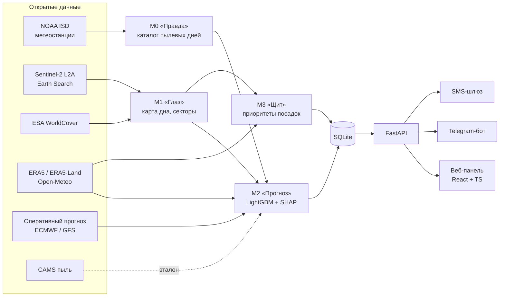

# AralShield «Тұз дауылы»

[](https://github.com/amir2014kayirbek-rgb/project/actions/workflows/ci.yml)


**Раннее предупреждение о солёно-пылевых бурях с высохшего дна Аральского моря для жителей Кызылординской области.**

AralShield («Тұз дауылы» — каз. «солевая буря») за 1–3 суток оценивает **вероятность пылевого дня** для конкретного
населённого пункта, показывает, **с какого участка высохшего дна** вероятнее всего придёт пыль, подсказывает,
**где посадки саксаула** защитят больше всего людей, и доставляет предупреждение людям — в **Telegram-боте и
веб-панели на казахском и русском языках**.

Система полностью программная и работает только на **открытых данных**: наблюдения метеостанций, спутниковые
снимки Sentinel-2, реанализ и прогнозы погоды. Никаких собственных датчиков.

> ⚠️ Информационный сервис. Он дополняет, но не заменяет официальные штормовые предупреждения
> [Казгидромета](https://www.kazhydromet.kz).

---

## Содержание

1. [Проблема](#1-проблема)
2. [Что делает AralShield](#2-что-делает-aralshield)
3. [Главные результаты](#3-главные-результаты)
4. [Архитектура](#4-архитектура)
5. [Пять модулей подробно](#5-пять-модулей-подробно)
6. [Данные](#6-данные)
7. [Как проверялась модель (честная проверка)](#7-как-проверялась-модель-честная-проверка)
8. [Веб-панель, бот и API](#8-веб-панель-бот-и-api)
9. [Запуск на своём компьютере](#9-запуск-на-своём-компьютере)
10. [Хостинг: бесплатно и на сервере](#10-хостинг-бесплатно-и-на-сервере)
11. [Тестирование и контроль качества](#11-тестирование-и-контроль-качества)
12. [Ограничения (честно)](#12-ограничения-честно)
13. [Что дальше](#13-что-дальше)
14. [Структура репозитория](#14-структура-репозитория)
15. [Источники и лицензии данных](#15-источники-и-лицензии-данных)

---

## 1. Проблема

- Аральское море за полвека потеряло около **90 %** водной поверхности. На его месте возникла новая пустыня
  **Аралкум**: около 4,5 млн га высохшего дна, из них ≈2,2 млн га в Казахстане.
- С высохшего дна ежегодно поднимается **75–100 млн т** солёной пыли. Она содержит соли, остатки пестицидов и тяжёлые металлы.
- В Кызылординской области живут **846 тыс.** человек. На побережье пыльные бури бывают в среднем **~60 суток
  в год**, в Кызылорде — 17–24 суток.
- По данным ВОЗ, до **50 %** детей Приаралья имеют хронические болезни дыхательных путей.

**Чего не хватает сегодня.** Штормовые предупреждения выпускаются для области целиком — без вероятности для
конкретного села и без указания источника пыли. Саксаул высаживают на сотнях тысяч гектаров, но открытого
инструмента, который выбирает участки по пользе для людей, нет. Спутниковые данные и прогнозы существуют
и бесплатны, но не соединены в продукт для жителя, школы и поликлиники.

## 2. Что делает AralShield

| Результат | Для кого | Как выглядит |
|---|---|---|
| **Вероятность пылевого дня** на сегодня, завтра и послезавтра для каждого пункта | жители, школы, поликлиники, акимат, ДЧС | 🟢 маловероятен · 🟡 возможен · 🟠 вероятен · 🔴 очень вероятен + процент |
| **Объяснение и источник** | все | «после 7 сухих дней — юго-западный ветер до 11 м/с; источник — юго-западная часть дна» |
| **Советы по роли** | учитель, врач, родитель, чабан, акимат | «перенесите физкультуру в зал», «держите скот в укрытии» |
| **Приоритеты посадок саксаула** | лесное хозяйство | карта ячеек 2×2 км, сценарий «1 000 га по рейтингу против случайных», выгрузка GeoJSON / KML / Shapefile |
| **Честная статистика точности** | все | «из 74 оповещений оранжевого уровня подтвердились 51» |

Пример настоящего сообщения бота учителю. Это архивное событие 4 апреля 2025 года — модель не видела этот год
при обучении, станция подтвердила пыльную бурю:

```
🔴 Кызылорда, завтра (пятница): пылевой день очень вероятен — >95%.
После 7 сухих дней — юго-западный ветер до 11 м/с.
Что делать: отмените занятия на улице; закройте окна; предупредите родителей.
Инфопрогноз, не официальное предупреждение: kazhydromet.kz

Текст для родителей (перешлите в чат класса):
Завтра ожидается пыльная погода, занятия на улице переносятся в помещение.
```

То же на казахском и SMS для чабана (≤ 70 знаков):

```
🔴 Қызылорда, ертең (жұма): шаңды күн болуы өте ықтимал — 95%-дан жоғары.
7 құрғақ күннен кейін оңтүстік-батыстан 11 м/с дейін жел.
Не істеу керек: далада өтетін сабақтарды өткізбеңіз; терезелерді жабыңыз; ата-аналарды ескертіңіз.

SMS: Ертең күшті шаңды дауыл. Малды қорада ұстаңыз. AralShield
```

## 3. Главные результаты

Все цифры — на **тестовых годах 2020–2025**, которые модель не видела при обучении. Полные таблицы —
[`reports/forecast_report.md`](reports/forecast_report.md).

| Что сравниваем (горизонт «сегодня») | PR-AUC ↑ | BSS ↑ |
|---|---|---|
| **AralShield M2 (LightGBM)**, погода из реанализа ERA5 | **0,655** [0,609–0,700] | **0,405** |
| AralShield на **настоящих оперативных прогнозах** ECMWF IFS 0,25° (2024–2025) | 0,536 | 0,206 |
| AralShield на **настоящих оперативных прогнозах** GFS (2022–2025) | 0,588 | 0,273 |
| Логистическая регрессия M1 | 0,553 | 0,322 |
| Лучшее простое правило «сильный порыв + сухость» (B2, откалибровано) | 0,449 | 0,228 |
| Климатология «как обычно в этом месяце» (B0) | 0,182 | 0 |
| Глобальный прогноз пыли **CAMS** (Copernicus), 2024–2025 | 0,149 | −0,014 |

- **Модель лучше всех простых правил** на всех трёх горизонтах, интервалы не пересекаются, BSS > 0, калибровка ECE < 0,01.
- В боевом режиме (оперативный прогноз погоды вместо реанализа) точность падает до 0,54–0,59, но остаётся
  **в 2+ раза выше** простого правила на тех же данных (0,25).
- **Аральск, последний проверяемый год** (25.08.2024–24.08.2025): из 74 оповещений оранжевого и красного уровня
  подтвердились **51**; поймано 86 % пылевых дней.
- **Реплей бури 4 апреля 2025 г.** (пыль на всех 4 станциях): накануне модель дала Кызылорде вероятность >95 %.

Проверка научных гипотез из отчёта:

| Гипотеза | Результат |
|---|---|
| **H2.** ML лучше простых правил | ✅ подтверждена на всех горизонтах |
| **H3.** Карта источников из «Глаза» улучшает прогноз | ◐ на «сегодня» — да (ΔPR-AUC +0,017, интервал 0,010–0,025); на «завтра/послезавтра» — не доказано |
| **H4.** Пыль в Аральске связана с пылью в Кызылорде | ✅ с учётом сезона: отношение шансов 2,7 (тот же день) и 1,85 (через сутки), p = 0,001; через 2 суток — нет |
| **H1.** Компьютерное зрение надёжно отличает солевую корку | ⚠️ не проверена честно: нет экспертной разметки (см. [ограничения](#12-ограничения-честно)) |

Приоритеты посадок: **1 000 га по рейтингу «Щита»** снижают пылевую нагрузку в эквиваленте **≈1 540 человек**,
1 000 га, размещённые случайно на пригодных участках, — в среднем ≈54.

## 4. Архитектура



**День из жизни системы** (планировщик, время UTC+5):

1. **05:30** — свежий оперативный прогноз погоды на 72 ч для каждой станции (Open-Meteo).
2. Признаки: ветер, порывы, часы выше 8–14 м/с, осадки и сухие дни, влажность почвы, синоптика и
   **наветренный индекс выноса** — доля сухой солевой корки в секторе, откуда дует ветер (из «Глаза»).
3. Модель выдаёт вероятности на 3 суток, уровни для каждой группы пользователей, объяснение (SHAP) и сектор-источник.
4. **06:00** — рассылка в Telegram/SMS тем, у кого риск не ниже выбранного порога; **18:00** — вечерняя SMS чабанам.
5. Если данных нет, прогноз выпускается в **упрощённом режиме** с пометкой и причиной (`degraded_reasons`), а не молчит.

## 5. Пять модулей подробно

### М0 «Правда» — каталог реальных пылевых дней (`aralshield/truth/`)

Модель учится на **наблюдениях**, а не на другой модели. Источник — синоптические сводки NOAA ISD за 2000–2025 гг.
по станциям Аральск (35746), Казалинск (35849), Жосалы (35953), Кызылорда (38062).

- Пылевой день — если за местные сутки (UTC+5) записан код погоды ВМО **06–09, 30–35 или 98**, либо видимость
  < 5 км без осадков, тумана, дымки и метели при ветре ≥ 6 м/с.
- Разбираются поле `MW1` и сама сводка SYNOP — и **современный, и старый формат AAXX** (2000–2013).
- При дублях срока синоптическая сводка FM-12 важнее METAR. Сутки, где переданы меньше 6 из 8 сроков,
  помечаются ненадёжными.
- Станционные годы, где код погоды почти не передавался (Казалинск), получают статус «метка неизвестна»:
  их нельзя считать днями без пыли.
- Итог: **3 328 пылевых дней** — Аральск ≈53 в год, Кызылорда ≈43, Жосалы ≈26.

### М1 «Глаз» — компьютерное зрение по Sentinel-2 (`aralshield/eye/`)

- **Медианный безоблачный композит** июнь–сентябрь 2025 г.: 80 снимков с 20 тайлов MGRS, облака, тени и снег
  маскируются по слою SCL. Покрытие области — 99,9 %, разрешение 250 м. Читаются только обзоры облачных
  COG-файлов, полные сцены не скачиваются.
- **Спектральные индексы** по разделу 12.3 отчёта: NDVI, NDWI, BSI, SI (засоление), TGSI (крупность), NMDI (сухость).
- **5 классов:** потенциальный источник (сухая солевая корка), песок, влажный солончак, растительность, вода.
  Классификатор — Random Forest на 400 деревьев.
- **Продукты:**
  - карта классов и вероятности источника;
  - доля источника в **16 секторах по 22,5°** вокруг каждого пункта в радиусе 300 км с весом `exp(−d/100 км)`;
    пробелы снимков не считаются «нет источника»;
  - слои для веб-карты.

### М2 «Прогноз» — вероятность пылевого дня (`aralshield/forecast/`)

- **Модель:** LightGBM с **монотонными ограничениями** (вероятность не падает при усилении ветра), изотонической
  калибровкой («70 %» ≈ 7 событий из 10) и объяснением каждого прогноза через SHAP.
- **Ключевой признак:** наветренный индекс выноса `U = Σₖ F(θₖ) · max(0, Vₖ − Vₜ)³`. Он соединяет физику
  (поток сальтации растёт как куб скорости ветра) и компьютерное зрение.
- **Базовые линии**, с которыми модель обязана сравниться: климатология (B0), «завтра как сегодня» (B1),
  правило «порыв + сухость» (B2 и откалиброванное B2-iso), прогноз пыли CAMS (B3), логистическая регрессия (M1),
  LightGBM без признаков «Глаза» (M2-abl, для гипотезы H3).
- **Пороги уровней** подобраны на валидации отдельно для групп:
  - здоровье (родители, люди с астмой) — низкий порог, важнее не пропустить;
  - школы — средний;
  - акимат и ДЧС — высокий, только уверенные события.
- **Аварийный режим:** без модели или погоды работает простое правило с пометкой «упрощённый режим».

### М3 «Щит» — где сажать саксаул (`aralshield/shield/`)

Дно делится на ячейки 2×2 км. Вклад ячейки `i` в пылевую нагрузку пункта `j`:

```
E_ij = S_i · P_ij · exp(−d_ij / L) · N_j        Priority_i = M_i · Σ_j E_ij
```

| Обозначение | Что это |
|---|---|
| `S_i` | вероятность того, что ячейка — источник («Глаз») |
| `P_ij` | доля часов с ветром выше порога, дующим **от ячейки к пункту** (климатология ERA5 2015–2024) |
| `d_ij`, `L` | расстояние и длина затухания (100 км) |
| `N_j` | население пункта |
| `M_i` | пригодность для посадки по индексам Kim et al. (2020) |

- **Устойчивость:** 180 сценариев чувствительности (L, порог ветра, веса пригодности). «Надёжный высокий» класс —
  ячейки, которые входят в топ в 80 %+ сценариев.
- **Сценарий «что если»:** «1 000 га по рейтингу» против «1 000 га случайно» и «ближе к сёлам».
- **Выгрузка** для ГИС лесного хозяйства: GeoJSON, KML, Shapefile.

### М4 «Голос» — доставка людям (`aralshield/api/`, `aralshield/voice/`, `frontend/`)

FastAPI-сервис, веб-панель на React + TypeScript, Telegram-бот на aiogram 3 и SMS-адаптер. Все тексты на
**казахском и русском**; цвет уровня всегда дублируется словом и значком. Подробнее — в [разделе 8](#8-веб-панель-бот-и-api).

## 6. Данные

| Источник | Для чего | Период и разрешение | Доступ |
|---|---|---|---|
| **NOAA ISD** (Integrated Surface Database) | метки пылевых дней | 2000–2025, каждые 3 ч | AWS Open Data `noaa-global-hourly-pds` |
| **ERA5 / ERA5-Land** | признаки погоды для обучения, роза ветров | 2000–2025, ежечасно | Open-Meteo Archive API |
| **Оперативные прогнозы** ECMWF IFS 0,25°, GFS | ежедневный выпуск и проверка боевого режима | 72 ч вперёд | Open-Meteo Forecast / Historical Forecast API |
| **CAMS** (Copernicus) | эталон B3 | 2022–2025 | Open-Meteo Air Quality API |
| **Sentinel-2 L2A** | карта дна | лето 2025, 10–20 м → 250 м | Earth Search (Element 84, AWS) |
| **ESA WorldCover 2021** | слабые метки воды и растительности | 10 м | AWS Open Data |

Готовые результаты конвейера (каталог событий, признаки, модели, карты, рейтинг посадок, архив прогнозов
тестовых лет) лежат в репозитории — проект запускается **без многочасовой загрузки данных**.
Сырые загрузки (`data/raw/`) и снимки `*.tif` в git не хранятся и пересоздаются командой `cli all`.

## 7. Как проверялась модель (честная проверка)

Главный риск учебных моделей прогноза — фантастическая точность на бумаге и провал в жизни. Против этого:

- **Метки — наблюдения станций**, а не модельная пыль (MERRA-2/CAMS не используются как «правда»).
- **Разбиение по времени:** обучение 2000–2015, валидация 2016–2019 (подбор, калибровка, пороги), тест 2020–2025,
  зазор 7 дней между частями.
- **Только то, что известно к 06:00 дня выпуска:** осадки — за прошедшие сутки, персистентность — по наблюдениям
  до дня выпуска.
- **Проверка на настоящих оперативных прогнозах** (ECMWF, GFS): на реанализе модель получает «идеальную» погоду,
  поэтому числа «завтра/послезавтра» на ERA5 — **верхняя граница**, и это написано прямо в отчёте.
- **Блочный бутстреп по неделям** для 95 % интервалов: соседние дни зависимы.
- **Ворота качества** (раздел 23.2 отчёта) считаются автоматически и показываются в панели (✓ или ✗), включая непройденные.
- **Гипотеза H3** засчитывается, только если нижняя граница интервала ΔPR-AUC > 0. **H4** — с учётом сезона
  (Мантель–Хензель по год-месяцам) и перестановкой недельных блоков.

## 8. Веб-панель, бот и API

### Веб-панель (React + TypeScript, Leaflet, Chart.js)

| Экран | Что показывает |
|---|---|
| **Карта рисков** | пункты, окрашенные по уровню на сегодня/завтра/послезавтра; объяснение, источник пыли, текст сообщения для выбранной роли; баннер, если прогноз устарел или упрощён |
| **Архив и точность** | календарь «прогноз против факта» по станциям; точность за 30/365 дней; таблица моделей против простых правил; ворота качества; реплей бури; SHAP; гипотеза H4; сравнение с CAMS и боевым режимом |
| **Источники пыли** | композит Sentinel-2 и карта классов со **шторкой «снимок ⟷ модель»**; вероятность источника; роза секторов вокруг пункта |
| **Приоритеты посадок** | ячейки по классам приоритета; фильтр пригодности; сценарии «что если»; выгрузка GeoJSON/KML/Shapefile по ключу |
| **Отчёты** | сводка на 3 суток для акимата и ДЧС (печать в PDF); предпросмотр сообщений бота и SMS; **демо-режим** на архивной буре; состояние системы |

Интерфейс полностью на двух языках (переключатель ҚАЗ/РУС), работает на телефоне и с клавиатуры, контраст по WCAG AA.

### Telegram-бот (aiogram 3)

| Команда | Что делает |
|---|---|
| `/start` | подписка: язык → пункт → роль → порог уровня |
| `/forecast` | прогноз на 3 суток с объяснением |
| `/demo` | показ на архивной буре (работает без интернета и погоды) |
| `/accuracy` | точность с указанием периода и источника |
| `/settings`, `/help` | настройки и объяснение уровней |
| `/stop` | отписка и **удаление всех данных** подписчика |

Хранится минимум: идентификатор чата, пункт, роль, язык, порог. Геолокация и данные о здоровье не собираются.
Учителю приходит готовый текст для родителей с кнопкой «Переслать». На следующий день после оповещения бот
спрашивает «Было пыльно?» — ответы обезличиваются (HMAC) и идут в контроль качества.

### REST API (`/docs` — интерактивная документация)

| Метод | Назначение | Доступ |
|---|---|---|
| `GET /v1/settlements`, `/v1/stations` | справочники пунктов и станций | открытый |
| `GET /v1/forecasts?settlement=aralsk` | прогноз на 3 суток (уровни по группам, факторы, источник, `stale`, `degraded_reasons`) | открытый |
| `GET /v1/forecasts/{id}/explanation` | вклад признаков (SHAP), входные данные | открытый |
| `GET /v1/accuracy?settlement=…&period=365d` | статистика точности | открытый |
| `GET /v1/messages/preview` | текст сообщения бота или SMS для роли и языка | открытый |
| `GET /v1/summary` | сводка для акимата | открытый |
| `GET /v1/demo` | архивное событие для показа | открытый |
| `GET /v1/priorities`, `POST /v1/scenarios` | рейтинг посадок, сценарии «что если» | открытый |
| `GET /v1/events`, `/v1/sources/maps`, `/v1/priorities/export` | архив событий, слои, выгрузка для ГИС | ключ `X-API-Key` |
| `POST /v1/subscriptions`, `/v1/feedback` | бот | внутренний ключ |
| `GET /v1/health` | свежесть прогноза и состояние моделей | открытый |

Защита: ключи API хранятся в виде хешей, внутренние методы закрыты ключом, есть проверка заголовка `Host`
(против DNS-rebinding), лимит запросов на IP, строгая проверка параметров путей, заголовки безопасности.

## 9. Запуск на своём компьютере

Нужны **Python 3.10+** и **Node.js 18+**.

**Windows (PowerShell):**

```powershell
git clone https://github.com/amir2014kayirbek-rgb/project.git aralshield
cd aralshield
powershell -ExecutionPolicy Bypass -File scripts\setup.ps1   # окружение, зависимости, сборка панели
.venv\Scripts\python.exe -m aralshield.cli backtest          # архив прогнозов в базу (≈1 мин)
.venv\Scripts\python.exe -m aralshield.cli daily             # свежий прогноз (нужен интернет)
.venv\Scripts\python.exe -m aralshield.cli serve             # http://127.0.0.1:8000
```

**Linux / macOS:**

```bash
git clone https://github.com/amir2014kayirbek-rgb/project.git aralshield && cd aralshield
python3 -m venv .venv && . .venv/bin/activate && pip install -r requirements.txt
(cd frontend && npm ci && npm run build)
python -m aralshield.cli backtest && python -m aralshield.cli daily && python -m aralshield.cli serve
```

Полный пересчёт с нуля (загрузка данных, карта дна, обучение — ≈40–60 мин): `python -m aralshield.cli all`.

| Команда `python -m aralshield.cli …` | Что делает |
|---|---|
| `truth` | М0: NOAA ISD → каталог пылевых дней |
| `eye` | М1: композит Sentinel-2 и карта дна (≈15–25 мин) |
| `dataset`, `train` | признаки и обучение М2 + отчёт `reports/forecast_report.md` |
| `shield` | М3: приоритеты посадок |
| `backtest` | архив «прогноз против факта» тестовых лет в базу |
| `daily` | выпуск прогноза на сегодня, завтра, послезавтра |
| `notify [--dry-run] [--hour 18]` | рассылка (без токена — в `data/outbox`) |
| `serve`, `bot` | API с панелью, Telegram-бот |
| `apikey --owner "Лесхоз"` | ключ API для партнёра |

Бот: получите токен у [@BotFather](https://t.me/BotFather), впишите `TELEGRAM_BOT_TOKEN` в `.env`
(шаблон — [`.env.example`](.env.example)) и запустите `cli bot`. Ежедневный запуск на Windows — `scripts\daily.ps1`
через Планировщик заданий (команда регистрации — в начале файла).

Разработка панели: `cd frontend && npm run dev` (http://localhost:5173, запросы `/v1` уходят на :8000).

## 10. Хостинг: бесплатно и на сервере

| Вариант | Цена | Что работает | Для чего |
|---|---|---|---|
| **Render Free** (+ GitHub Actions) | 0 ₸ | панель, API, ежедневный прогноз; сервис засыпает без запросов, база пересоздаётся при перезапуске | показ жюри, ссылка в презентации |
| **Туннель Cloudflare** с ноутбука | 0 ₸ | всё, включая бота, пока ноутбук включён | быстрый показ «прямо сейчас» |
| **VPS + Docker Compose** | от ~2 000 ₸/мес | всё постоянно: панель с HTTPS, планировщик, бот, подписки | пилот с реальными пользователями |

**Бесплатно на Render — за 5 минут:**

1. Зайдите на [render.com](https://render.com) через GitHub → **New → Blueprint** → выберите этот репозиторий.
   Render прочитает [`render.yaml`](render.yaml) и соберёт Docker-образ (≈10 минут при первом деплое).
2. Откройте адрес вида `https://aralshield-xxxx.onrender.com` — панель работает сразу: данные и модели уже в образе,
   база собирается при старте за ~20 с, свежий прогноз появляется примерно через минуту.
3. Чтобы утром сайт сам «просыпался» и обновлял прогноз: в GitHub → **Settings → Secrets and variables → Actions →
   Variables** добавьте `SITE_URL` = ваш адрес на Render. Workflow [`wake.yml`](.github/workflows/wake.yml)
   будет будить сайт в 05:40 и 12:00.

Ограничения бесплатного варианта: первое открытие после простоя занимает ≈1 минуту; Telegram-бот там постоянно
не работает (для показа бота запустите `cli bot` на ноутбуке). Свой домен можно бесплатно подключить к Render
через Cloudflare DNS.

**Свой сервер:** `docker compose up -d --build` — панель с HTTPS (Caddy), планировщик 05:30/18:00 и бот.
Пошаговая инструкция, выбор сервера в Казахстане (закон о персональных данных), перенос данных, обновления
и резервные копии — **[docs/HOSTING.md](docs/HOSTING.md)**.

## 11. Тестирование и контроль качества

- **139 автоматических тестов** (pytest), например:
  - разбор сводок SYNOP старого и нового формата;
  - границы местных суток;
  - защита от утечки в признаках;
  - метрики;
  - геометрия секторов и ориентация полигонов;
  - формула приоритета;
  - API: доступы, обход пути, валидация;
  - дедупликация рассылки;
  - бот;
  - длина SMS ≤ 70 знаков.
- **CI (GitHub Actions)** на каждый push: тесты, сборка панели, сборка Docker-образа и проверка его запуска.
- **Независимая проверка проекта 20 агентами** (отчёты в [`reports/qa/`](reports/qa/)):
  - **15 тестировщиков** с разных точек зрения: валидность ML, разбор данных, погода, компьютерное зрение,
    математика посадок, безопасность, контракт API, код React, доступность в браузере, казахский и русский тексты,
    бот, рассылка, покрытие требований, эксплуатация, производительность;
  - **судья** свёл ~200 находок в 99 задач и проверил все критичные по коду;
  - **4 исправителя** их закрыли.
  Две критичные находки:
  - ошибка разбора старых сводок давала 1 500 ложных пылевых дней;
  - «оперативный» архив погоды на части станций оказался реанализом.
  После исправления все метрики пересчитаны.

## 12. Ограничения (честно)

**Прогноз**
- Числа «завтра/послезавтра» на ERA5 — **верхняя граница** (фактическая погода дня). Цена перехода на оперативный
  прогноз измерена только для горизонта 0–24 ч (PR-AUC 0,68 → 0,54 на ECMWF, 0,67 → 0,59 на GFS).
- Оперативный ветер ECMWF слабее ERA5 (≈ ×0,97–0,98), GFS — сильнее (≈ ×1,2). Квантильная поправка не сделана.
- **Метки неоднородны:** Казалинск почти не передаёт коды погоды, поэтому большинство его лет помечены
  «метка неизвестна». Данные NOAA за 2025 г. заканчиваются 24.08.2025, за 2026 г. ещё не опубликованы.
  Поэтому живые прогнозы выпускаются без признака «пыль в последние дни» и помечаются как «сниженная уверенность».
- Точность в панели и боте — это **архив тестовых лет** 2020–2025, а не проверка боевых выпусков: живая проверка
  невозможна, пока NOAA не опубликует свежие наблюдения. Текст точности всегда называет период и источник.
- Карта источников одна (лето 2025) и используется для всех лет 2000–2025.

**Карта дна («Глаз»)**
- Разметка **слабая**: вода и растительность — из ESA WorldCover, три класса голого дна — спектральные правила.
  Кросс-валидационная «точность» ≈ 1,0 на таких метках **неинформативна**, и панель её точностью не называет.
  Согласие с WorldCover — не независимая проверка (≈ уровень «всегда самый частый класс»).
  Гипотеза H1 поэтому не проверена: нужна экспертная разметка в QGIS (раздел 12.4 отчёта).
- Не реализованы: U-Net, помесячные карты, Sentinel-1 и рельеф, проверка по точкам старта шлейфов MODIS.
- Область снимков заканчивается на 44,3° с. ш. / 62,3° в. д., поэтому секторы Жосалы и Кызылорды покрыты плохо и замаскированы.

**Посадки («Щит»)**
- Ворота устойчивости рейтинга (τ Кендалла ≥ 0,7) **не пройдены**: τ ≈ 0,36 на 180 сценариях. Надёжны классы
  и совпадение топа, а не точный порядок ячеек.
- Пригодность — индекс по спектру, без доступности от дорог и без грунтовых вод. Население пунктов — округлённые оценки.

**Сервис**
- База — SQLite (схема повторяет PostgreSQL-версию отчёта). Нет e-mail-канала, экрана администрирования
  и нагрузочных тестов на 100 тыс. подписчиков.
- Казахские тексты требуют вычитки носителем языка.

## 13. Что дальше

1. **Экспертная разметка** дна (QGIS, 400 точек и 40–60 патчей) → честная проверка H1, затем U-Net.
2. **Данные Казгидромета** напрямую: свежие наблюдения для персистентности и живой проверки точности.
3. **Проверка на сроках 1–2 суток** по архиву прогонов (Open-Meteo `previous_day1/2`) и квантильная поправка ветра.
4. **Пилот:** 3–5 школ Аральска и Казалинска, районная поликлиника, лесхоз; офис ВОЗ в Кызылорде как партнёр по здоровью.
5. Помесячные карты источников и **мониторинг приживаемости посадок** по спутнику.
6. Масштабирование на Каракалпакстан и другие высыхающие солёные озёра (код переносится сменой области и списка станций).

## 14. Структура репозитория

```
aralshield/                Python-пакет
  truth/isd.py             М0: NOAA ISD → каталог пылевых дней
  eye/                     М1: композит Sentinel-2, классификация, секторы источников
  forecast/                М2: признаки, датасет, обучение и отчёт, метрики, ежедневный выпуск
  shield/priority.py       М3: приоритеты посадок, сценарии, выгрузки
  weather/                 адаптеры Open-Meteo (ERA5, прогноз, CAMS) с повторами
  voice/                   М4: тексты KZ/RU, Telegram-бот, рассылка
  api/                     FastAPI: прогнозы, точность, карты, посадки, демо
  db.py, config.py, cli.py база SQLite, настройки, командная строка
frontend/                  веб-панель React 18 + TypeScript (Vite, react-leaflet, Chart.js)
tests/                     139 тестов pytest
data/                      готовые результаты конвейера (сырые загрузки — не в git)
models/                    обученные модели и пороги уровней
reports/                   отчёты о проверке, графики, отчёты QA (reports/qa)
deploy/                    запуск на Render, планировщик, Caddyfile
docs/HOSTING.md            инструкция по хостингу
scripts/                   установка и ежедневный запуск на Windows
Dockerfile, docker-compose.yml, render.yaml, .github/workflows/
```

## 15. Источники и лицензии данных

- Данные **Copernicus** (Sentinel-2, ERA5, CAMS) — свободная лицензия Copernicus с указанием источника;
  **ESA WorldCover** — CC BY 4.0; погодные API — [Open-Meteo](https://open-meteo.com) (CC BY 4.0).
- **NOAA ISD** — открытые данные NOAA. Перед коммерческим использованием проверить условия
  перераспределения данных станций или заключить соглашение с Казгидрометом.
- Методология опирается на работы, процитированные в исходном отчёте проекта: Micklin (1988), Shao (2008),
  Indoitu et al. (2015), Kim et al. (2020), Löw et al. (2022), Banks et al. (2022), Wang et al. (2023),
  Xi et al. (2025), Галаева и Идрисова (2007) и др.

---

*AralShield «Тұз дауылы». Прогноз информационный и не является официальным предупреждением.*
