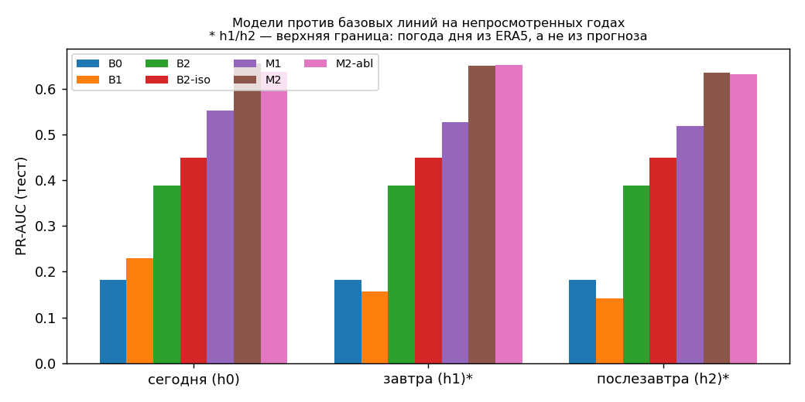
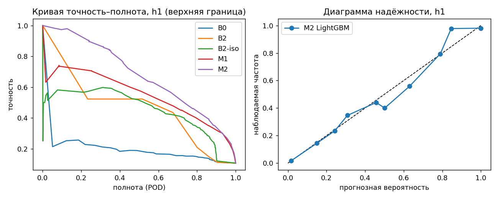
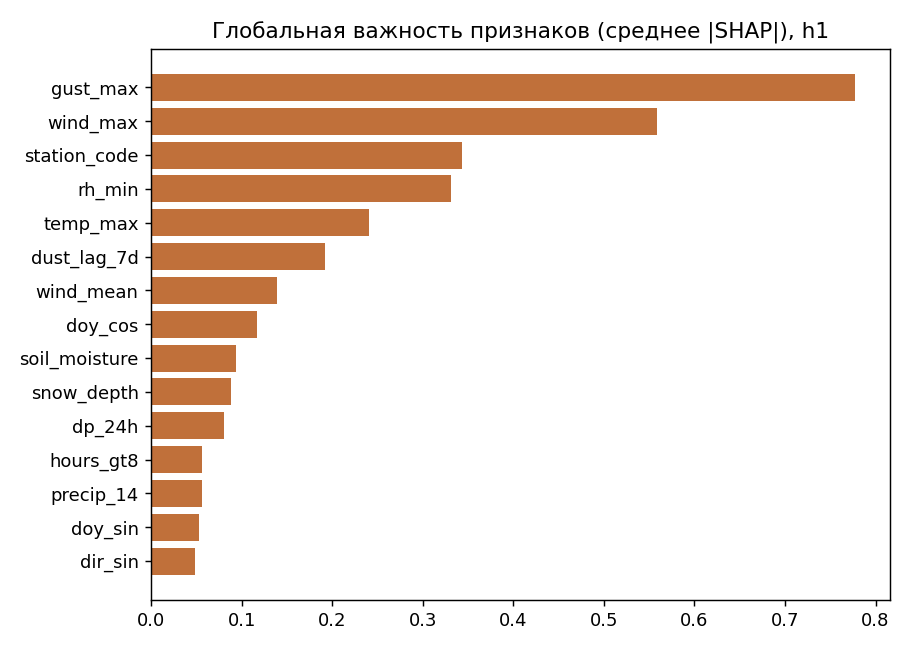

# Отчёт модуля «Прогноз»

Версия модели: `forecast-lgbm-1.1.0`, создан 2026-10-31T20:08:10.

Метки — наблюдения метеостанций (коды ВМО и видимость, NOAA ISD); признаки — ERA5 (Open-Meteo).
Тест — годы, которые модель не видела. Интервалы — 95% блочный бутстреп по неделям.
BSS считается относительно климатологии станция × месяц по обучению + валидации; в скобках — относительно выборочной климатологии самого теста.

**Важно:** погода целевых суток во всех горизонтах берётся из реанализа ERA5 (фактическая погода дня). Поэтому числа h1/h2 — **верхняя граница (фактическая погода дня)**, а не качество прогноза на 1–2 суток; цена перехода на оперативный прогноз — в разделе «Проверка на архиве оперативных прогнозов».

Данные: 2025 — неполный год: архив NOAA ISD заканчивается 2025-08-24, метки после этой даты отсутствуют.

## Горизонт h0 (сегодня)

Разбиение (годы, строк, событий): {'train': [2000, 2015, 17771, 2066], 'valid': [2016, 2019, 4342, 441], 'test': [2020, 2025, 6948, 741]}

| Модель | PR-AUC | ROC-AUC | Brier | BSS (выбор. клим.) | ECE | ECE квант. |
|---|---|---|---|---|---|---|
| B0 | 0.182 | 0.664 | 0.0932 | 0.000 (-0.040) | 0.032 | 0.032 |
| B1 | 0.229 | 0.670 | 0.0875 | 0.061 (0.023) | 0.016 | 0.017 |
| B2 | 0.389 [0.343…0.424] | 0.794 | 0.0726 | 0.220 (0.189) | 0.005 | 0.024 |
| B2-iso | 0.449 [0.399…0.502] | 0.841 | 0.0719 | 0.228 (0.197) | 0.023 | 0.034 |
| M1 | 0.553 | 0.916 | 0.0631 | 0.322 (0.295) | 0.013 | 0.014 |
| M2 | 0.655 [0.609…0.700] | 0.929 | 0.0554 | 0.405 (0.381) | 0.006 | 0.006 |
| M2-abl | 0.638 [0.591…0.684] | 0.927 | 0.0571 | 0.387 (0.362) | 0.009 | 0.008 |

Правило B2: порыв ≥ 13.0 м/с и ≥ 1 сухих суток (CSI 0.351; без условия сухости — 0.340). B2-iso — откалиброванная непрерывная линия P(событие | порыв) по станциям.

Топ признаков (среднее |SHAP|): gust_max, wind_max, station_code, rh_min, temp_max, dust_lag_7d, wind_mean, doy_cos, soil_moisture, dp_24h

H3 подтверждена: ΔPR-AUC (M2 − M2 без признаков источника) = 0.017 [0.010…0.025], ΔBSS = 0.018 [0.011…0.026] (парный блочный бутстреп; гипотеза принимается, только если нижняя граница ΔPR-AUC > 0).

Ворота качества: {"pr_auc_beats_best_baseline": true, "pr_auc_ci_separated": true, "best_baseline": "B2-iso", "bss_positive": true, "ece_le_0_05": true, "ece_quantile": 0.006292515761530304, "per_station_not_worse_than_B2": true, "wind_in_top3_shap": true, "H3_source_features_help": true, "H3_delta_pr_auc": 0.017324009704370202, "H3_delta_pr_auc_ci": [0.010041159109601272, 0.025037861509424348], "H3_delta_bss_ci": [0.010745001582930522, 0.026091086746168453], "weather_inputs": "era5_actual_same_day", "pr_auc_beats_B3_cams": true}

Пороги уровней по группам для h0 (валидация, калибровка вне выборки): {"health": {"yellow": 0.1, "orange": 0.16, "red": 0.68}, "school": {"yellow": 0.22, "orange": 0.37, "red": 0.68}, "public": {"yellow": 0.22, "orange": 0.37, "red": 0.68}, "akimat": {"yellow": 0.22, "orange": 0.37, "red": 0.68}}

- health: порог 0.16 → POD 0.89, FAR 0.63, CSI 0.35
- school: порог 0.37 → POD 0.61, FAR 0.39, CSI 0.44
- public: порог 0.37 → POD 0.61, FAR 0.39, CSI 0.44
- akimat: порог 0.37 → POD 0.61, FAR 0.39, CSI 0.44

## Горизонт h1 (завтра; верхняя граница (фактическая погода дня))

Разбиение (годы, строк, событий): {'train': [2000, 2015, 17771, 2066], 'valid': [2016, 2019, 4342, 441], 'test': [2020, 2025, 6948, 741]}

| Модель | PR-AUC | ROC-AUC | Brier | BSS (выбор. клим.) | ECE | ECE квант. |
|---|---|---|---|---|---|---|
| B0 | 0.182 | 0.664 | 0.0932 | 0.000 (-0.040) | 0.032 | 0.032 |
| B1 | 0.157 | 0.613 | 0.0937 | -0.006 (-0.046) | 0.015 | 0.020 |
| B2 | 0.389 [0.343…0.424] | 0.794 | 0.0726 | 0.220 (0.189) | 0.005 | 0.024 |
| B2-iso | 0.449 [0.399…0.502] | 0.841 | 0.0719 | 0.228 (0.197) | 0.023 | 0.034 |
| M1 | 0.526 | 0.911 | 0.0650 | 0.303 (0.274) | 0.014 | 0.013 |
| M2 | 0.650 [0.602…0.693] | 0.926 | 0.0563 | 0.395 (0.371) | 0.006 | 0.004 |
| M2-abl | 0.652 [0.604…0.696] | 0.927 | 0.0560 | 0.399 (0.375) | 0.006 | 0.005 |

Правило B2: порыв ≥ 13.0 м/с и ≥ 1 сухих суток (CSI 0.351; без условия сухости — 0.340). B2-iso — откалиброванная непрерывная линия P(событие | порыв) по станциям.

Топ признаков (среднее |SHAP|): gust_max, wind_max, station_code, rh_min, temp_max, dust_lag_7d, wind_mean, doy_cos, soil_moisture, snow_depth

H3 не подтверждена: ΔPR-AUC (M2 − M2 без признаков источника) = -0.002 [-0.007…0.004], ΔBSS = -0.004 [-0.010…0.001] (парный блочный бутстреп; гипотеза принимается, только если нижняя граница ΔPR-AUC > 0).

Ворота качества: {"pr_auc_beats_best_baseline": true, "pr_auc_ci_separated": true, "best_baseline": "B2-iso", "bss_positive": true, "ece_le_0_05": true, "ece_quantile": 0.004371453443289464, "per_station_not_worse_than_B2": true, "wind_in_top3_shap": true, "H3_source_features_help": false, "H3_delta_pr_auc": -0.0017371503012914014, "H3_delta_pr_auc_ci": [-0.007286817078829735, 0.003559177069450914], "H3_delta_bss_ci": [-0.009624786469549632, 0.0012989099769881336], "weather_inputs": "era5_actual_upper_bound"}

Пороги уровней по группам для h1 (валидация, калибровка вне выборки): {"health": {"yellow": 0.11, "orange": 0.18, "red": 0.73}, "school": {"yellow": 0.16, "orange": 0.27, "red": 0.73}, "public": {"yellow": 0.16, "orange": 0.27, "red": 0.73}, "akimat": {"yellow": 0.2, "orange": 0.33, "red": 0.73}}

- health: порог 0.18 → POD 0.77, FAR 0.54, CSI 0.41
- school: порог 0.27 → POD 0.66, FAR 0.43, CSI 0.44
- public: порог 0.27 → POD 0.66, FAR 0.43, CSI 0.44
- akimat: порог 0.33 → POD 0.57, FAR 0.37, CSI 0.43

## Горизонт h2 (послезавтра; верхняя граница (фактическая погода дня))

Разбиение (годы, строк, событий): {'train': [2000, 2015, 17771, 2066], 'valid': [2016, 2019, 4342, 441], 'test': [2020, 2025, 6948, 741]}

| Модель | PR-AUC | ROC-AUC | Brier | BSS (выбор. клим.) | ECE | ECE квант. |
|---|---|---|---|---|---|---|
| B0 | 0.182 | 0.664 | 0.0932 | 0.000 (-0.040) | 0.032 | 0.032 |
| B1 | 0.141 | 0.593 | 0.0949 | -0.018 (-0.060) | 0.016 | 0.025 |
| B2 | 0.389 [0.343…0.424] | 0.794 | 0.0726 | 0.220 (0.189) | 0.005 | 0.024 |
| B2-iso | 0.449 [0.399…0.502] | 0.841 | 0.0719 | 0.228 (0.197) | 0.023 | 0.034 |
| M1 | 0.518 | 0.911 | 0.0650 | 0.302 (0.274) | 0.014 | 0.016 |
| M2 | 0.635 [0.587…0.683] | 0.927 | 0.0565 | 0.393 (0.369) | 0.008 | 0.004 |
| M2-abl | 0.632 [0.582…0.677] | 0.926 | 0.0566 | 0.393 (0.368) | 0.006 | 0.002 |

Правило B2: порыв ≥ 13.0 м/с и ≥ 1 сухих суток (CSI 0.351; без условия сухости — 0.340). B2-iso — откалиброванная непрерывная линия P(событие | порыв) по станциям.

Топ признаков (среднее |SHAP|): gust_max, wind_max, rh_min, station_code, temp_max, dust_lag_7d, doy_cos, wind_mean, snow_depth, soil_moisture

H3 не подтверждена: ΔPR-AUC (M2 − M2 без признаков источника) = 0.003 [-0.004…0.011], ΔBSS = 0.000 [-0.005…0.006] (парный блочный бутстреп; гипотеза принимается, только если нижняя граница ΔPR-AUC > 0).

Ворота качества: {"pr_auc_beats_best_baseline": true, "pr_auc_ci_separated": true, "best_baseline": "B2-iso", "bss_positive": true, "ece_le_0_05": true, "ece_quantile": 0.003980968694214438, "per_station_not_worse_than_B2": true, "wind_in_top3_shap": true, "H3_source_features_help": false, "H3_delta_pr_auc": 0.003427145715319324, "H3_delta_pr_auc_ci": [-0.003767303756551954, 0.010720352505859579], "H3_delta_bss_ci": [-0.004582983219559069, 0.006162411490538278], "weather_inputs": "era5_actual_upper_bound"}

Пороги уровней по группам для h2 (валидация, калибровка вне выборки): {"health": {"yellow": 0.11, "orange": 0.18, "red": 0.61}, "school": {"yellow": 0.17, "orange": 0.29, "red": 0.61}, "public": {"yellow": 0.17, "orange": 0.29, "red": 0.61}, "akimat": {"yellow": 0.22, "orange": 0.36, "red": 0.61}}

- health: порог 0.18 → POD 0.75, FAR 0.51, CSI 0.42
- school: порог 0.29 → POD 0.66, FAR 0.42, CSI 0.45
- public: порог 0.29 → POD 0.66, FAR 0.42, CSI 0.45
- akimat: порог 0.36 → POD 0.52, FAR 0.34, CSI 0.41

## Сравнение с CAMS (B3)

Период 2024-01-01..2025-08-24, горизонт 0: AralShield PR-AUC 0.676, BSS 0.423; CAMS PR-AUC 0.149, BSS -0.014.

Оговорка: сравнение не равноправное — AralShield здесь получает фактическую погоду дня (ERA5), а CAMS — собственный модельный прогноз пыли (изотонически откалиброван на 2022-08…2023). Равноправное сравнение — с признаками из оперативного прогноза (см. ниже).

## Проверка на архиве оперативных прогнозов погоды

Модель ecmwf_ifs025: доля часов ветра, совпадающих с ERA5: aralsk 0.01, kazalinsk 0.02, zhosaly 0.01, kyzylorda 0.01; исключённых нет.
Станции aralsk, kazalinsk, kyzylorda, zhosaly, период 2024-02-04..2025-08-24 (2158 сут), горизонт 0. Признаки из ERA5: PR-AUC 0.680, BSS 0.427. Признаки из оперативного прогноза: PR-AUC 0.536 [0.457…0.611], BSS 0.206. Правило B2 на оперативных данных: PR-AUC 0.248. Отношение «прогноз / ERA5»: максимальный ветер 0.98, порывы 0.97, часы > 8 м/с 1.18. Доля пропусков: {"gust_max": 0.495, "soil_moisture": 0.056, "snow_depth": 1.0}.
Open-Meteo Historical Forecast, модель ecmwf_ifs025 (склейка первых часов прогонов) ≈ горизонт 0–24 ч.

Модель gfs_seamless: доля часов ветра, совпадающих с ERA5: aralsk 0.00, kazalinsk 0.00, zhosaly 0.00, kyzylorda 0.00; исключённых нет.
Станции aralsk, kazalinsk, kyzylorda, zhosaly, период 2022-01-02..2025-08-24 (4818 сут), горизонт 0. Признаки из ERA5: PR-AUC 0.666, BSS 0.423. Признаки из оперативного прогноза: PR-AUC 0.588 [0.530…0.639], BSS 0.273. Правило B2 на оперативных данных: PR-AUC 0.246. Отношение «прогноз / ERA5»: максимальный ветер 1.22, порывы 1.03, часы > 8 м/с 2.65. Доля пропусков: {"gust_max": 0.0, "soil_moisture": 1.0, "snow_depth": 0.0}.
Open-Meteo Historical Forecast, модель gfs_seamless (склейка первых часов прогонов) ≈ горизонт 0–24 ч.

## Гипотеза H4 (Аральск → Кызылорда)

Совместная встречаемость пыли в Аральске и Кызылорде сверх сезонного хода значима на сдвигах 0 и 1 сут; на сдвиге 2 сут — не значима. Перенос пыли из Аральска этим не доказан: возможна общая синоптическая причина.

Метод: ОШ Мантеля–Хензеля, страты год–месяц; p — перестановка недельных блоков внутри календарного месяца (999 перестановок), односторонняя (ОШ > 1).

- сдвиг 0 сут: ОШ М–Х = 2.70, p (перестановки) = 0.001; наивно OR = 3.68, p (Фишер) = 3.2e-67; P(Кызылорда) = 0.122, P(Кызылорда | Аральск) = 0.278 — значимо
- сдвиг 1 сут: ОШ М–Х = 1.85, p (перестановки) = 0.001; наивно OR = 2.71, p (Фишер) = 1e-37; P(Кызылорда) = 0.122, P(Кызылорда | Аральск) = 0.236 — значимо
- сдвиг 2 сут: ОШ М–Х = 1.07, p (перестановки) = 0.263; наивно OR = 1.73, p (Фишер) = 2.2e-11; P(Кызылорда) = 0.122, P(Кызылорда | Аральск) = 0.179 — не значимо

## Реплей события из тестовых лет

Дата: 2025-04-04, пыль на 4 станциях (признаки — ERA5, верхняя граница). Подробности — reports/forecast_metrics.json.

## Ограничения

- h1/h2 оценены с фактической погодой целевого дня (ERA5): это верхняя граница; реальное качество прогноза на 1–2 суток ниже и не измерено.
- Обучение на реанализе завышает точность боевого режима; проверка на архиве оперативных прогнозов выполнена только на станциях с настоящим прогнозом (aralsk, kazalinsk, kyzylorda, zhosaly); исключённых станций нет.
- Оперативный ветер систематически слабее ERA5 (максимальный ветер ×0.98, порывы ×0.97): модель монотонна по ветру, поэтому в боевом режиме возможен сдвиг к недопредупреждению; квантильная коррекция не выполнялась.
- Карта источников «Глаза» статична (композит 2025 г.) и применяется ко всем годам 2000–2025, включая тест: формально это информация из будущего (нарушение правила 13.3 «карты только из прошлых месяцев»); H3 поэтому проверяет направленный вес источника, а не его динамику.
- Метки по видимости зависят от практики наблюдателя и перехода на автоматические станции; станционные годы без передачи кода погоды считаются без метки ({"kazalinsk": [2000, 2001, 2002, 2003, 2004, 2005, 2006, 2007, 2008, 2009, 2010, 2011, 2012, 2013, 2014, 2016, 2017, 2018, 2019, 2020, 2021, 2022]}).
- 2025 — неполный год: архив NOAA ISD заканчивается 2025-08-24, метки после этой даты отсутствуют.